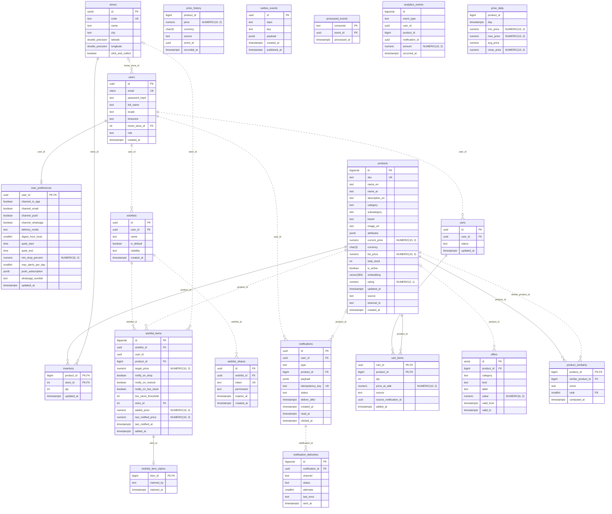

# Database ERD

The [SQL migrations](../db/migrations) define the physical schema. This diagram shows foreign keys and cardinality. The migration ledger is independent of application data.

`price_history` and `analytics_events` are TimescaleDB hypertables. `price_daily` is a continuous aggregate over `price_history`, grouped by product and UTC day. The migrations keep historical event and aggregate identifiers as logical references.

- One default wishlist and one active cart per user are enforced with partial unique indexes.
- Inventory is unique per product and store. Wishlist items are unique per wishlist and product.
- Product identity is unique per `source` and `external_id` pair.
